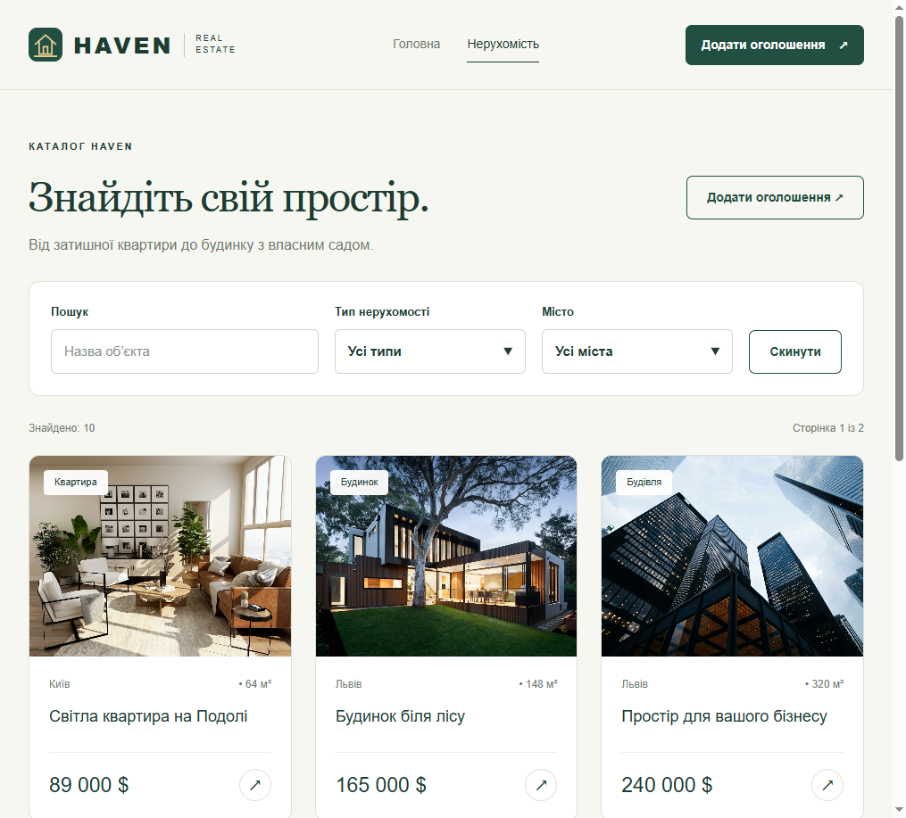
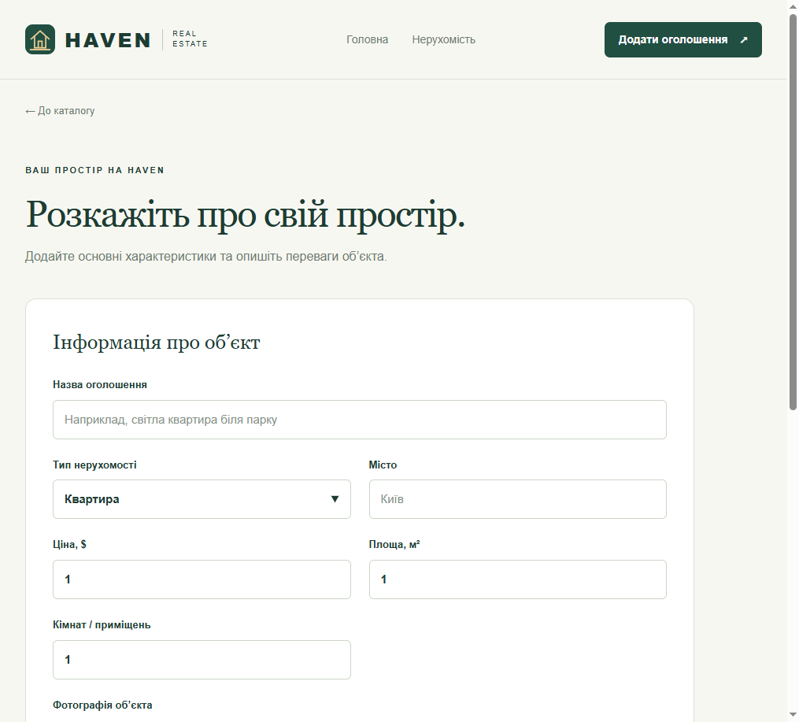
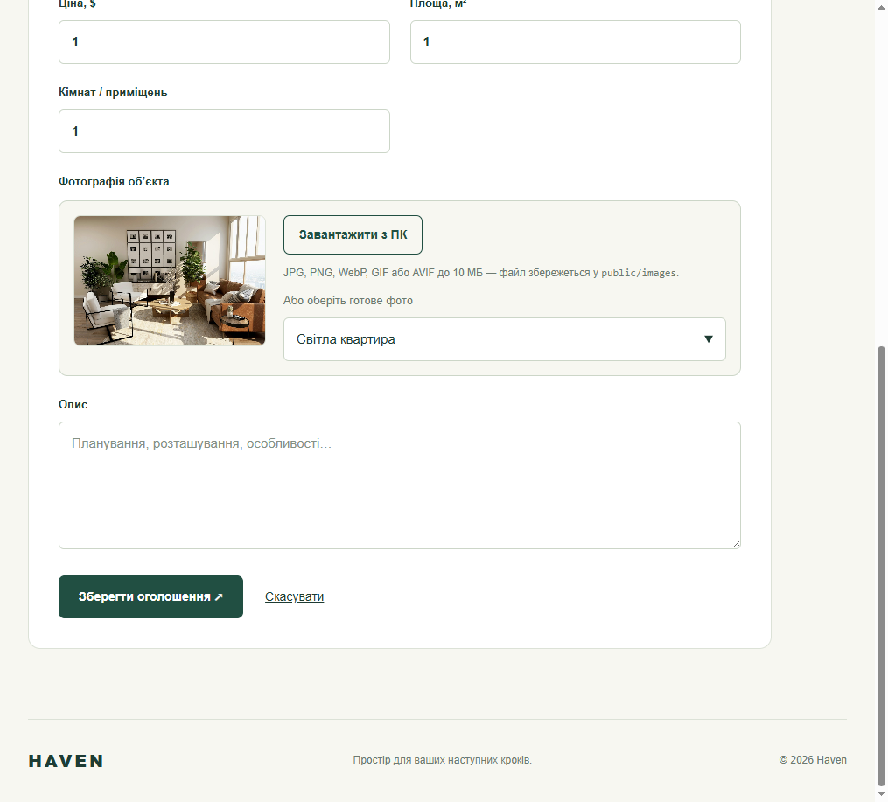

START
```sh
npm install
npm start
```


TEST
```sh
npm test
```

---

# Звіт з лабораторної роботи №3: Angular

## 1. Мета роботи та опис застосунку

**Мета:** опанувати створення односторінкового вебзастосунку (SPA) на **Angular** із використанням сучасних підходів — standalone-компонентів, реактивного керування станом через **Signals**, **Reactive Forms** із валідацією, маршрутизації з лінивим завантаженням, взаємодії з REST API через **HttpClient** та **HTTP-інтерцепторів**, а також модульного тестування.

---

## 2. Архітектура та структура проєкту

Застосунок організовано за шарами відповідальності:

```text
├── public/
│   ├── images/                  # Фотографії оголошень (готові та завантажені з ПК)
│   └── logo.svg                 # Логотип Haven
├── scripts/
│   ├── api-server.mjs           # Локальний API-сервер (проксі до json-server + POST /upload у public/images)
│   └── start.mjs                # Одночасний запуск API та Angular dev-сервера
├── src/
│   ├── main.ts                  # Точка входу: bootstrapApplication, provideRouter, provideHttpClient + interceptor
│   ├── styles.scss              # Глобальні адаптивні стилі застосунку
│   └── app/
│       ├── app.component.ts     # Кореневий standalone-компонент (шапка, навігація, <router-outlet>, футер)
│       ├── app.routes.ts        # Таблиця маршрутів із lazy loading (loadComponent)
│       ├── core/
│       │   ├── product.ts                  # Модель даних Product, ProductInput та список категорій
│       │   ├── products.service.ts         # CRUD-сервіс (HttpClient) + завантаження фото (uploadImage)
│       │   ├── logging.interceptor.ts      # Функціональний HTTP-інтерцептор для логування й обробки помилок
│       │   ├── products.service.spec.ts    # Unit-тести сервісу з HttpTestingController
│       │   └── logging.interceptor.spec.ts # Unit-тести інтерцептора
│       ├── shared/
│       │   └── property-card.component.ts  # Перевикористовувана картка об’єкта (input.required)
│       └── pages/
│           ├── home.component.ts           # Головна сторінка з переходом по категоріях
│           ├── products-list.component.*   # Каталог із фільтрами, пошуком, пагінацією та тестами
│           ├── product-details.component.* # Деталі об’єкта, стани loading/error, видалення з підтвердженням
│           ├── product-form.component.*    # Форма створення/редагування (Reactive Forms) + завантаження фото
│           └── not-found.component.ts      # Сторінка 404
├── db.json                      # База даних json-server
└── proxy.conf.json              # Проксування /api/** та /images/** на локальний API-сервер
```

### Ключові архітектурні рішення

1. **Standalone-компоненти та маршрутизація (`app.routes.ts`)**  
   Усі компоненти реалізовано без `NgModule` (`standalone: true`). Сторінки підвантажуються ліниво через `loadComponent`:

   | Маршрут | Компонент | Призначення |
   | --- | --- | --- |
   | `/` | `HomeComponent` | Головна сторінка, швидкий перехід за категоріями |
   | `/products` | `ProductsListComponent` | Каталог, пошук, фільтри за типом і містом, пагінація |
   | `/products/new` | `ProductFormComponent` | Створення нового оголошення |
   | `/products/:id` | `ProductDetailsComponent` | Детальний перегляд об’єкта, редагування, видалення |
   | `/products/:id/edit` | `ProductFormComponent` | Редагування існуючого оголошення |
   | `**` | `NotFoundComponent` | Обробка неіснуючих маршрутів (404) |

2. **Керування станом через Signals**  
   - У `ProductsListComponent` локальний стан (`products`, `loading`, `error`, `category`, `city`, `search`, `page`) реалізовано на `signal()`, а похідні значення (`cities`, `filtered`, `pageCount`, `visible`) обчислюються автоматично через `computed()`.
   - У `ProductDetailsComponent` стан завантаження, помилок і видалення (`product`, `loading`, `error`, `deleting`, `confirming`, `deleteError`) також побудовано на сигналах.
   - Для оптимізації рендерингу застосовано `ChangeDetectionStrategy.OnPush` у всіх компонентах та `@for (product of visible(); track product.id)` у списках.

3. **Сервіси, Dependency Injection та HTTP-інтерцептор**  
   - `ProductsService` (`@Injectable({ providedIn: 'root' })`) інкапсулює роботу з REST API (`/api/products`): `list()`, `get(id)`, `create(product)`, `update(id, product)`, `delete(id)` та `uploadImage(file)` (`POST /api/upload`).
   - `loggingInterceptor` підключено в `main.ts` через `provideHttpClient(withInterceptors([loggingInterceptor]))`. Він логує всі запити в консоль і перетворює мережеві/HTTP-помилки на зрозумілі повідомлення українською мовою.
   - Локальний сервер `scripts/api-server.mjs` запускає `json-server`, проксіює CRUD-запити, приймає зображення `JPG / PNG / WebP / GIF / AVIF` до 10 МБ, зберігає їх у `public/images/` з унікальною назвою та одразу віддає за маршрутом `/images/...`.

4. **Reactive Forms, валідація та завантаження фото**  
   - `ProductFormComponent` використовує `FormBuilder.nonNullable.group` із валідаторами `Validators.required`, `minLength`, `maxLength`, `min`, `max`, `pattern(/^\d+$/)` та власним валідатором `nonBlank` (забороняє рядки з одних пробілів).
   - Форма працює в обох режимах (додавання і редагування) та дозволяє завантажити фото з комп’ютера з миттєвим попереднім переглядом або обрати готове зображення зі списку.

---

## 3. Скриншоти роботи застосунку

### Головна сторінка (`/`)
Стартова сторінка з навігаційною панеллю, головним банером та плитками переходу до категорій нерухомості.


### Каталог об’єктів (`/products`)
Відображення карток нерухомості, пошук за назвою, фільтрація за типом і містом, лічильник знайдених об’єктів та пагінація.



### Деталі оголошення (`/products/:id`)
Сторінка окремого об’єкта з характеристиками (площа, кількість кімнат, місто), описом та панеллю керування (перехід до редагування і видалення з підтвердженням).


### Форма створення / редагування оголошення (`/products/new`, `/products/:id/edit`)
Форма на базі Reactive Forms із валідацією полів:



Блок завантаження фотографії з ПК у папку `public/images`, попередній перегляд обраного зображення та альтернативний вибір готового фото:



---

## 4. Тестування

Модульні тести написано за допомогою **Vitest** та Angular **TestBed** (разом із `HttpTestingController` для мокування HTTP-запитів). Запуск виконується командою `npm test`.

Покриті сценарії (4 тестові файли, **19 тестів пройдено**):
- **`logging.interceptor.spec.ts` (3 тести):** логування методу й URL запиту, мапінг помилки `404` та мережевих збоїв.
- **`products.service.spec.ts` (7 тестів):** `GET` списку, `GET` за id, `POST` створення, `PUT` оновлення, `DELETE` видалення, `POST /api/upload` завантаження зображення та прокидання помилок сервера.
- **`products-list.component.spec.ts` (4 тести):** завантаження каталогу, фільтрація за категорією/містом/пошуком, пагінація та обробка помилок.
- **`product-form.component.spec.ts` (5 тестів):** відхилення порожніх назв/коротких описів/некоректних чисел, збереження валідних даних із `trim()` і навігація, збереження введених даних при помилці сервера, завантаження вибраного файлу перед збереженням та відхилення невалідних типів файлів.

```text
 ✓ haven src/app/core/logging.interceptor.spec.ts (3 tests)
 ✓ haven src/app/core/products.service.spec.ts (7 tests)
 ✓ haven src/app/pages/products-list.component.spec.ts (4 tests)
 ✓ haven src/app/pages/product-form.component.spec.ts (5 tests)

 Test Files  4 passed (4)
      Tests  19 passed (19)
```

---

## 5. Висновки

У межах лабораторної роботи №3 було розроблено повнофункціональний односторінковий застосунок **Haven** на Angular. Реалізовано компонентну архітектуру на базі **Standalone Components**, налаштовано ліниву маршрутизацію, побудовано реактивне керування станом за допомогою **Signals**, створено форми з валідацією на **Reactive Forms**, реалізовано повний CRUD через **HttpClient** із функціональним інтерцептором та завантаженням власних фотографій у `public/images`. Коректність роботи сервісу, інтерцептора та ключових компонентів підтверджено 19 модульними тестами та успішною production-збіркою (`npm run build`).
